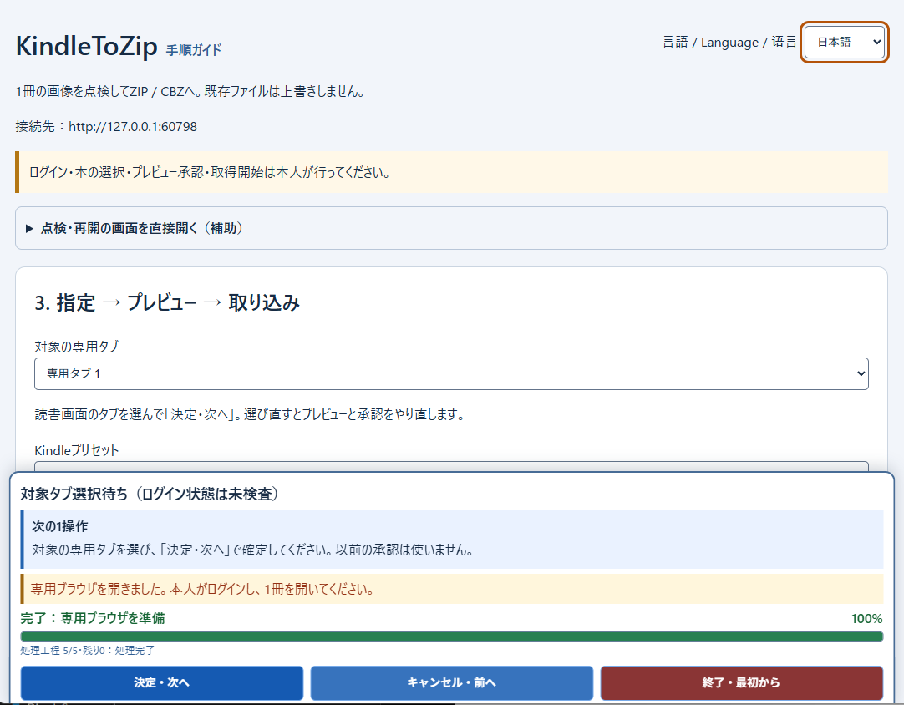

[English](README.md) | [日本語](README.ja.md) | [简体中文](README.zh-CN.md)

# KindleToZip

WindowsでKindle Webの表示画面をPNG画像として取得し、点検して順序付きのZIP / CBZに保存するツールです。

**完全無料・オープンソース · Windows x64 · 独自アカウント登録不要 · 有料DLCなし**

> **開発中：ソース公開のみ。一般公開されたPortable実行ファイルはまだありません。**
> 既知のテスト失敗が残っており、動作確認済みの完成版ではありません。

**[ソースから試す・入門ガイド](docs/getting-started.ja.md)** · [公開リリースの状況](https://github.com/zufall-upon/KindleToZip/releases)

## 開く・取得する・点検して保存する

**開く → 取得する → 点検して保存**

1. **開く。** 専用ブラウザのKindle公式画面で本人がログインし、1冊を開いて読書タブを選びます。
2. **取得する。** 取得領域を指定してプレビューを確認します。承認した後、別の操作で取得を開始します。
3. **点検して保存。** 停止後に保存済み画像を確認し、順序やクロップを調整してZIP / CBZへ出力します。

これは**3つの工程であり、3クリックで完了するという意味ではありません**。画面の「次の1操作」と、主操作の **「決定・次へ」「キャンセル・前へ」「終了・最初から」** に沿って進めます。

## アプリ画面

*作者提供の実画面から操作ウィンドウだけを切り出しています。日本語UIのログイン状態未確認の画面で、書籍本文は表示していません。[原寸で開く](docs/images/kindletozip-workflow.png)。*

## 主な機能

以下はソースに実装済みの機能です。ただし、後述の既知の問題が残っています。

- **専用ブラウザ：** 普段のブラウザとは別のプロファイルでKindle Webの読書画面を表示します。
- **領域指定とプレビュー：** 表示中の取得領域を選び、保存前に内容を確認できます。
- **ページ取得：** 本人の明示開始後にページ送りを行い、表示画像をPNGのスクリーンショットとして保存します。
- **見開き分割と順序調整：** 左右ページへの分割、読み方向の選択、取得画像の並べ替えに対応します。
- **画像の点検：** 原本を削除せず採用・除外を変更し、非破壊クロップを適用できます。
- **ZIP / CBZ出力：** 採用したPNGを指定順で保存します。既存の出力ファイルは上書きしません。
- **停止後の点検：** 確定保存された画像は、取得し直さずに点検・出力できます。
- **3言語UI：** 言語メニューから日本語・英語・簡体字中国語を選べます。

## はじめに・入手方法

**現在、一般公開されたWindows Portable版のダウンロードはありません。** 開発中の版を試す場合は、[ソース実行の入門ガイド](docs/getting-started.ja.md)へ進んでください。**Windows x64・Git・Node.js 22以降・PowerShell 7** が必要です。ガイド内で専用のRust環境とブラウザを導入します。

準備後にプロジェクトのフォルダで `npm start` を実行すると、ローカルの操作画面が開きます。専用ブラウザの起動からプレビュー・取得・保存まで、画面の案内に沿って進めます。実書籍を使わず確認する場合は、ガイドの自作試料を利用できます。

開発環境不要のアプリを希望する場合は、今後の[リリース](https://github.com/zufall-upon/KindleToZip/releases)を確認してください。Portable版のビルド用スクリプトが存在することと、検証済み実行ファイルが公開されていることは**別です**。

### よくある質問

**無料ですか？ 別のアカウント登録は必要ですか？**

無料・オープンソースで、KindleToZip独自の登録や有料の機能解除は不要です。Kindle公式サービスにはAmazonアカウントと、対象コンテンツの購入・契約が必要な場合があります。

**Windows Portable版のEXEはどこから入手できますか？**

一般公開の実行ファイルはまだありません。現時点ではソースから試すか、正式な公開リリースをお待ちください。

**DRMを解除しますか？ Windows版Kindleアプリでも使えますか？**

いいえ。Kindle Webの表示画面を取得する方式です。書籍ファイルの復号、DRM・撮影制限の回避、デスクトップ版Kindleの操作は行いません。

**1冊すべてを正しい順番で自動保存できますか？**

保証していません。取得範囲・順序・見開きの分割・停止位置は本人が点検してください。ZIPの検証成功だけでは、全ページの取得済みを意味しません。

**アプリの言語は変えられますか？**

はい。言語メニューで日本語・英語・簡体字中国語を選べます。言語対応は実装済みですが、検証記録には言語切り替え導線のテスト失敗も残っています。

## 安全性とプライバシー

- **ログインは公式画面だけで。** アプリ独自の認証サーバーはありません。パスワード欄の値を意図して読み取ったり、AmazonのCookieをアプリ運営側のサービスへ送信したりする実装ではありません。
- **ログイン状態は既定で保存します。** 保存設定をOFFにすると、別の一時プロファイルを使用します。一時データは通常終了時に削除しますが、異常終了では残る場合があります。
- **保存データは共有しないでください。** 開発版は `artifacts/mvp-data/`、PortableビルドはEXE横の `runtime/`・`data/`・`temp/` を使用します。Cookie・履歴・書籍情報・取得画像を含む可能性があるため、公開や不具合報告への添付は避けてください。
- **通信は発生します。** 公式の読書・認証サービス、ブラウザ、初回導入はネットワークへ接続します。アプリ独自のテレメトリ・自動更新確認・支援ページへの自動アクセスはありませんが、Chromiumや公式サイトによる他の通信まで行われないという意味ではありません。

詳細は[認証情報・通信先・信頼境界](docs/security-and-trust.md)（英語）へ。ソース公開は点検を可能にしますが、**安全性を自動的に保証しません**。ローカルトークンやWindowsの権限は、マルウェア・管理者・同じWindows利用者の別プロセスからの保護を保証するものではありません。

## 制限事項・法律上の注意

- **既知の失敗：** 初回公開ソースの `npm test` は、親テスト・子テストの失敗を含め **125成功・12失敗、約576秒** でした。Rust・IPC/local-store・配置テストは別途成功しています。文書の刷新で失敗を修正・免除したことにはしません。[検証記録](docs/validation.md)（英語）を参照してください。
- **動作保証の範囲：** クリーンなWindows環境、Kindleの全レイアウト、全冊取得、ZIP64、すべてのCBZビューアは未検証です。現在の入口は日本向けKindle Webで、他地域は未確認、デスクトップ版は非対応です。
- **画像上限：** 標準・2倍の描画密度を選べますが、安全上の上限は **PNGごとに16メガピクセル・32 MiB** です。元の表示にない細部を復元するものではありません。見開き分割は内容を意味的に認識する機能ではないため、結果を点検してください。
- **DRMを解除しなくても、適法・規約適合とは限りません。** Amazonの利用規約には、ロボットなどのデータ収集・抽出ツールが利用許可に含まれない旨があります。自動取得やツール配布には、契約・著作権上の問題が残ります。権限のあるコンテンツだけを扱ってください。GPLv3は書籍の利用権や取得ページの再配布を許諾するものではありません。

KindleToZipは**Amazon非公式・非提携**で、Amazonの承認・支援を受けた製品ではありません。AmazonおよびKindleはAmazon.com, Inc.または関連会社の商標です。Amazonや法律の専門家による確認済みとはしていません。利用前に[法的な論点と調査の限界](docs/legal-notes-ja.md)をお読みください。

## 開発を支援する

KindleToZipは無料・オープンソースです。役立ったと感じたら、**[zufall-uponのGitHub Sponsors](https://github.com/sponsors/zufall-upon)** から開発支援をご検討ください。

支援は**完全に任意**です。基本機能の利用料・有料の枚数制限・透かし・有料DLCはありません。Sponsorsは審査中・未公開の場合、作者プロフィールへ転送されることがあります。**支援受付の開始は確認できていません**。感想や不具合報告も歓迎します。

## ライセンス・開発者向け文書

Copyright (C) 2026 **[zufall-upon](https://github.com/zufall-upon)**。ライセンスは **GNU GPL v3.0のみ**（`GPL-3.0-only`）です。[LICENSE](LICENSE)を参照してください。無保証で提供し、第三者の依存物にはそれぞれのライセンスが適用されます。

- [文書一覧](docs/README.md) — 入門ガイドと言語別の入口
- [開発・テスト・Portableビルド](docs/development.md)（英語）
- [検証結果と既知の失敗](docs/validation.md)（英語）
- [リリース・SHA-256・ビルド証明](docs/releasing.md)（英語）
- [セキュリティと通信の詳細](docs/security-and-trust.md)（英語）
- [法的な注意事項](docs/legal-notes-ja.md)
- [Rust JSONL IPC契約](docs/09-mvp-ipc-ja.md)

[GitHub Actions](https://github.com/zufall-upon/KindleToZip/actions)にはソース検査と、別途手動起動する**Draft Release用ワークフロー**があります。存在するだけで、リリース合格・独立監査・法務承認・ビット単位での再現性を証明するものではありません。
