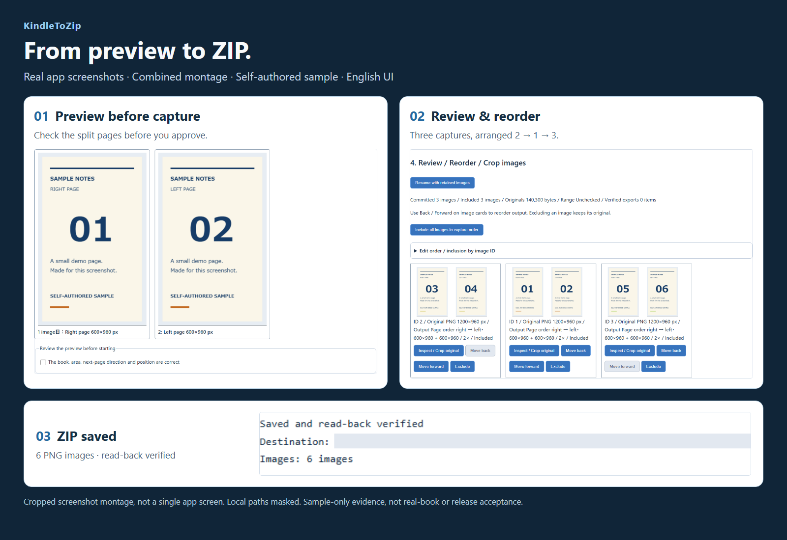
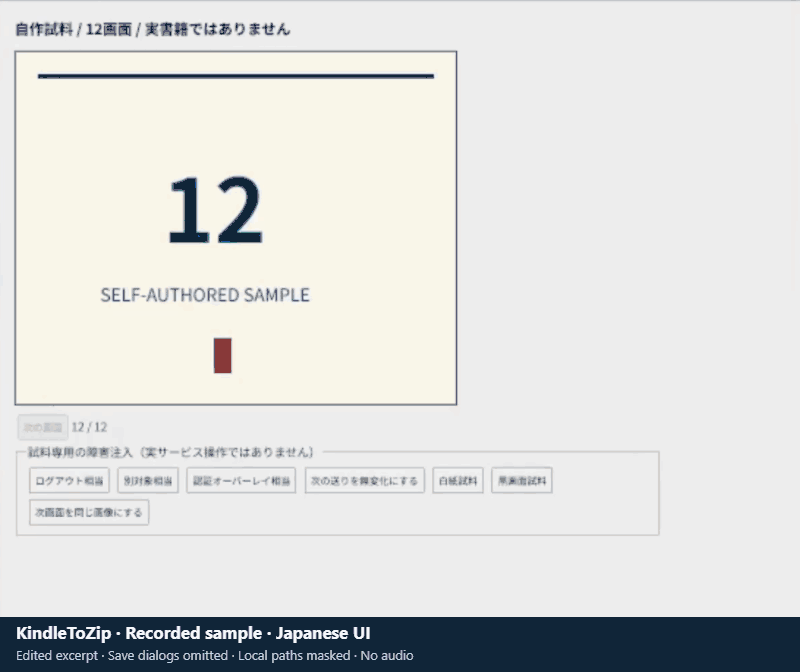

[English](README.md) | [日本語](README.ja.md) | [简体中文](README.zh-CN.md)

# KindleToZip

  

**截取、整理、归档。**

在 Windows 上截取 Kindle 网页阅读器中显示的页面，检查、拆分并整理 PNG／JPEG 截图，再按顺序保存为 **ZIP / CBZ**。

**在后台截取页面，等待时也能继续处理其他工作。**

**完全免费、开源 · Windows x64 · 无需注册 KindleToZip 账户 · 无付费 DLC**

> **Windows x64 Portable v0.1.6 现已提供。**
> 必需的源代码检查与打包版本自制样本检查已通过；用户已确认本次本地裁剪与地区选择候选，但未说明详细范围。此前干净Windows与真实书籍完整获取报告针对v0.1.2，并非本次托管EXE的结果。

**[下载 Portable ZIP](https://github.com/zufall-upon/KindleToZip/releases/download/v0.1.6/KindleToZip-Portable-v0.1.6-win-x64.zip)** · [Portable 使用指南](docs/portable.md) · [从源代码体验](docs/getting-started.zh-CN.md)

   

## 开发缘起

以前使用的 Kindle 图书转 ZIP 方法不知何时失效了，因此我开发了 KindleToZip。它截取 Kindle 网页阅读器显示的页面，而不是解密电子书文件。

获取期间无需让专用阅读窗口一直处于前台，可以在其他应用中工作。设计目标是让等待时间也能用来处理其他事情，获取后再检查、整理图像并保存为压缩包。

## 从阅读页面到压缩包

1. **打开。** 在专用浏览器的 Kindle 官方页面登录，打开一本书并选择阅读标签页。
2. **获取。** 选择区域并检查预览。确认后，通过另一次操作明确开始获取。
3. **检查并保存。** 停止后检查图像，调整拆分、顺序或裁剪，再导出 ZIP / CBZ。

**后台获取的条件：** 保持专用阅读窗口打开且不最小化，并让电脑保持唤醒、未锁屏。不保证最小化、锁屏或睡眠期间继续获取。开始前仍须预览与确认，结束后仍须检查获取范围和页面顺序。

*使用自制样本的真实英语界面，由截图裁剪组合而成，并非模型图。本地导出路径已遮挡。样本成功不代表真实书籍获取或打包发行版已经通过验证。*

**查看原尺寸：** [预览](docs/screenshots.md#preview) · [检查与跨页拆分](docs/screenshots.md#review) · [ZIP 保存](docs/screenshots.md#export) · [日语界面](docs/screenshots.md#japanese-ui)

观看简短操作动图（日语界面 · 约8秒）

*经过编辑的无声样本片段：已省略保存对话框，并遮挡本地路径。不验证真实书籍或发行版。[录制说明与静态图片](docs/screenshots.md#animation)。*

## 让截图更好用

Portable 版本与源代码包含以下功能，验证范围与限制见下文：

- **获取前先检查。** 专用浏览器配置、区域选择、预览与明确确认，之后再单独开始。
- **拆分与排序。** 可选左右跨页拆分、阅读方向选择和图像重排。
- **保留原图。** 调整采用或排除状态，进行非破坏性裁剪；停止后无需重新获取即可检查已保存的图像。
- **有序归档。** 将采用的 PNG／JPEG 导出为 ZIP / CBZ，不覆盖已有文件。
- **选择界面语言。** 支持日语、英语和简体中文。

**v0.1.4 新增功能：** 可选择 PNG 或 JPEG 获取，并将 JPEG 画质设为 1–100。JPEG 获取时为有损压缩，裁剪和拆分时会再次压缩。可在检查时逐张更正为一页或左右两页并选择顺序。可手动裁剪边距并恢复原图。自动判断可能出错，请务必目视检查。已选择的小型下一页按钮与获取区域重叠时，可在安全条件下仅于截图期间隐藏；不能保证消除所有遮挡。

**v0.1.6 新增功能：** 在检查界面选择图像并点击“检测所选图像的空白”，可将连续白色或黑色边缘空白的候选与原图比较。仅预览或取消不会改变保存状态。确认正文、边框和页码保留后再明确应用；仍可手动裁剪或恢复原始尺寸。这不是内容识别，也可能找不到安全候选。应用 JPEG 裁剪时按获取时的画质重新压缩，原图仍会保留。

v0.1.6 新增 **Kindle 使用地区** 选择，可选 **日本、美国、英国**，独立于界面语言（每次启动默认为日本）。请在打开专用浏览器前选择；更改地区前先关闭浏览器，然后重新选择目标标签页、预览并确认。各地区真实账户与书籍仍未验证。[适配器基础与未来计划](docs/store-adapters.md)将商店专用行为与通用图像处理分离。BOOK☆WALKER、ebookjapan、コミックシーモア **尚不支持**；各自条款、复制条件及获准样本验证将于未来接入时另行处理。上述功能已包含在下方的 v0.1.6 Portable ZIP 中。

## 开始使用

**Portable：** 下载 [v0.1.6 发布 ZIP](https://github.com/zufall-upon/KindleToZip/releases/tag/v0.1.6)，用 `SHA256SUMS.txt` 校验后完整解压到可写目录，再运行 `KindleToZip-Portable.exe`。已包含 Node.js 与专用浏览器，无需开发环境。详见[三语 Portable 指南](docs/portable.md)。

**从源代码：** 需要 **Windows x64、Git、Node.js 22+ 和 PowerShell 7**。[入门指南](docs/getting-started.zh-CN.md)会安装隔离的 Rust 工具链与浏览器，再通过 `npm start` 启动。建议先体验自制样本，无需 Amazon 登录或真实书籍。

**Ubuntu 实验性源码版：** `linux-port` **仅用于自制样本**，不支持真实 Kindle、常规 Wayland 阅读，也不提供 Linux 下载包。请复用现有隔离环境，参见 [Ubuntu 源码说明](docs/getting-started.zh-CN.md#ubuntu-source)。控制窗口有界面，样本阅读器默认 headless。显式运行 `npm start -- --sample-headed` 仅为应用生成的标准自制样本打开专用 Wayland 窗口，不授权其他网站或已有配置文件。目标内检查不保证其他应用、物理输入不受干扰，也不保证整个操作系统画面不被遮挡。已安装的 `/usr/bin/zenity` 可作为可选保存位置选择器；仍可手动输入，选择路径不会开始保存或获取。桌面／portal 行为需要按环境验证，这不代表已发布 Linux 版本。

在 Ubuntu 26.04 中，已通过本人操作，使用已安装的 Zenity 验证匿名 ZIP/CBZ 保存位置选择与取消，并收到显示正常的本人目视报告。原生对话框图像未提供，也未独立检查。这些检查确认仅选择位置不会导出文件；ZIP/CBZ 输出与内容核对是另行进行的集成检查，不代表原生选择器导出或真实 Kindle 已验收。

## 使用前须知

- **质量：** v0.1.6 已通过精确源代码commit的必需CI与带标签发布的全部关卡，包括公开源代码界面、部署、打包版本公开选择及导出回归。早期失败保留为历史。用户对本地图像改进的确认及此前v0.1.2的干净Windows、真实书籍完整获取报告，与本次托管EXE的自动样本检查分开记录。详见[验证历史与发布记录](docs/validation.md)（英语）。
- **登录与本地数据：** 只在官方页面登录。**默认保存登录状态。** 关闭保留设置后会使用独立的临时配置，正常退出时删除，但异常退出可能留下文件。不要分享配置、Cookie、书籍信息或截图。详见[隐私与存储说明](docs/security-and-trust.md)（英语）。
- **网络与信任：** 没有应用自建的登录服务器、遥测或自动更新检查。官方阅读与认证服务、浏览器和安装过程仍会联网。开源**不等于安全保证**，详见[网络目标与信任边界](docs/security-and-trust.md)（英语）。
- **兼容性：** v0.1.6 可独立于界面语言选择日本、美国或英国的 Kindle 入口；各地区真实书籍、所有布局、ZIP64 和所有 CBZ 阅读器均未验证。用户确认的干净 Windows 与真实书籍运行情况不保证所有环境和书籍。标准 / 2倍渲染有**每张图像 1600万像素 / 32 MiB** 的上限，无法恢复原始显示中不存在的细节。
- **条款与权利：** 不移除 DRM **不代表已获得法律或条款许可**。Amazon 的使用条件将机器人等数据收集工具排除在使用许可之外；自动获取和工具分发仍存在未解决的合同与版权问题。仅处理获准截取的内容，未经许可不要再分发页面。请阅读[法律注意事项](docs/legal-notes-ja.md)（日语）。

KindleToZip 是**非官方、独立项目**，与 Amazon 无关联，未获其认可或赞助。Amazon 和 Kindle 是 Amazon.com, Inc. 或其关联公司的商标。本项目不声称已获得 Amazon 或法律专业人士的批准。

## 常见问题

**免费吗？需要另行注册账户吗？**

KindleToZip 免费且开源，无需另行注册，没有付费配额、水印或付费功能解锁。Amazon 的账户要求及适用的内容购买或订阅仍然有效。

**它能移除 DRM，或操作 Windows 版 Kindle 桌面应用吗？**

不能。它截取网页阅读器显示的内容，不解密电子书文件，不绕过 DRM 或截图限制，也不操作桌面应用。

**能按正确顺序保存整本书吗？**

不保证。请自行检查范围、页面顺序、跨页拆分和停止位置。ZIP 验证成功不代表整本书已完整获取，拆分也不是语义页面识别。

**可以切换应用语言吗？**

可以在语言菜单选择日语、英语或简体中文。当前源代码 CI 已通过公开语言切换流程检查；[验证历史](docs/validation.md)保留早期失败，并区分源代码与打包版本的验证范围。

## 支持开发

如果这个项目对你有帮助，欢迎[通过 Ko-fi 请我喝杯咖啡](https://ko-fi.com/zufallupon)。**支持完全自愿**，不影响任何功能的使用。

也欢迎反馈与[问题报告](https://github.com/zufall-upon/KindleToZip/issues)。同时保留 [GitHub Sponsors](https://github.com/sponsors/zufall-upon) 链接，但可能跳转至作者主页；目前尚未确认**通过 GitHub Sponsors 接受赞助**。

## 文档与许可证

[文档索引](docs/README.md) · [开发与构建](docs/development.md)（英语） · [发布验证](docs/releasing.md)（英语） · [截图与文档审查](docs/readme-review.md)（英语）

[GitHub Actions](https://github.com/zufall-upon/KindleToZip/actions) 包括源代码检查和单独手动运行的 Draft Release 工作流，不代表已具备发布质量、经过独立审计或能够按字节重现构建。

Copyright (C) 2026 **[zufall-upon](https://github.com/zufall-upon)**。**GNU GPL v3.0，仅此版本**（`GPL-3.0-only`），详见 [LICENSE](LICENSE)。软件不提供担保，依赖保留各自许可证；GPLv3 不授予书籍或所获取页面的使用权。
