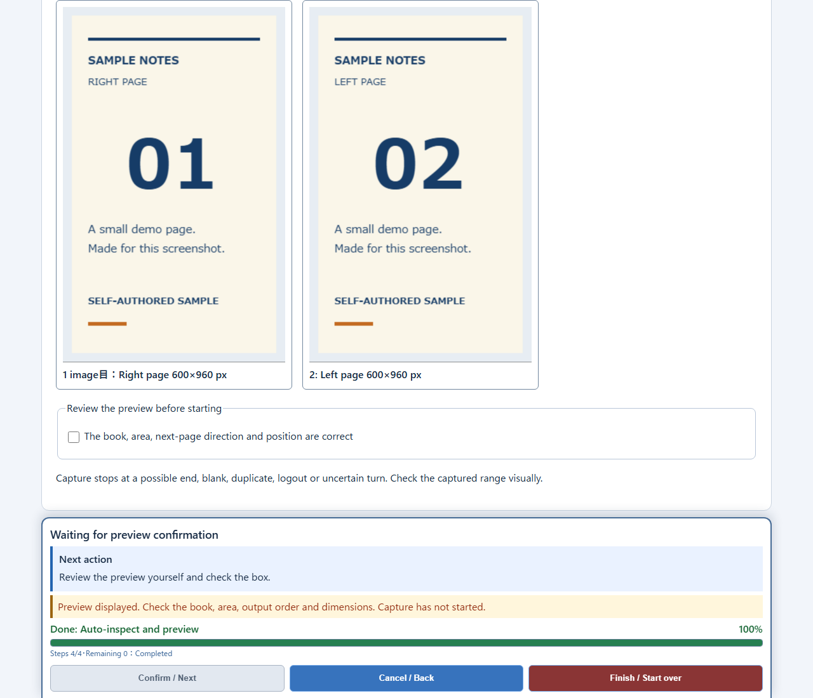
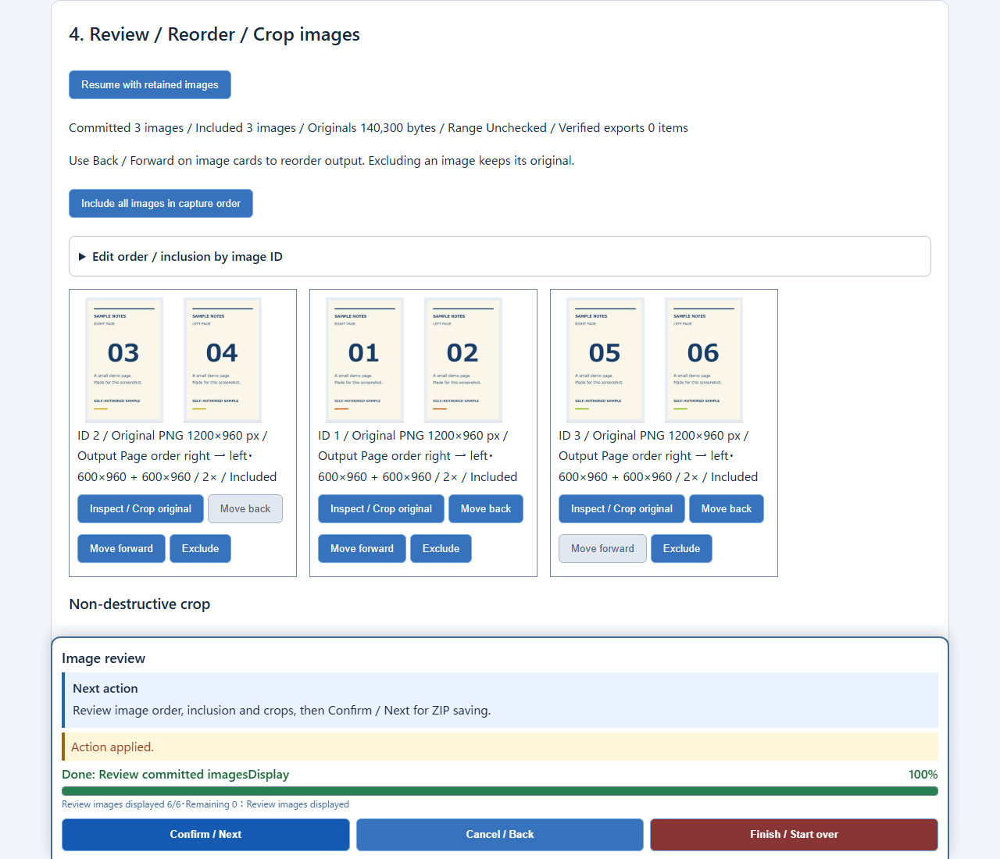
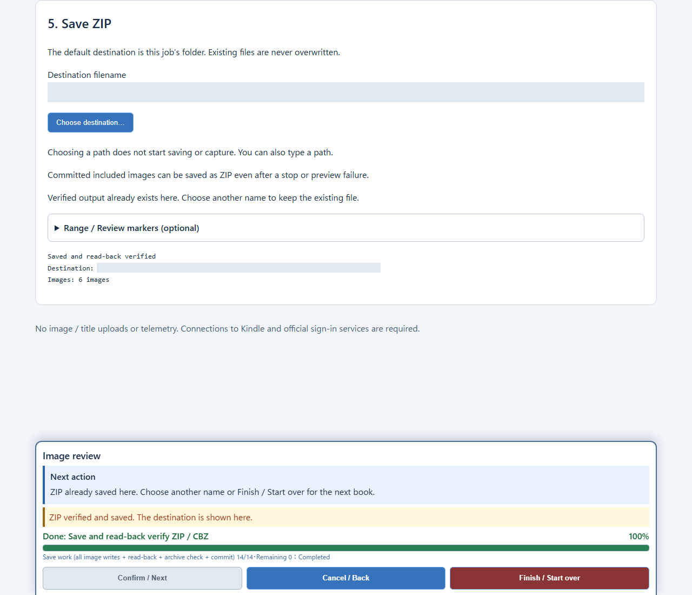

# KindleToZip in action / 実画面 / 实际界面

[English](../README.md) · [日本語](../README.ja.md) · [简体中文](../README.zh-CN.md)

Actual English UI from published source **`9f95a73`**, using only self-authored local sample content. No Amazon login, normal browser profile, or real book was used. These screenshots demonstrate one sample flow, **not** real-book completeness, clean-Windows compatibility, or packaged-release acceptance. Local export paths are masked; UI messages and image counts are unchanged.

公開済みソース **`9f95a73`** の英語UIを、自作のローカルサンプルだけで操作した実画面です。Amazonへのログイン・普段のブラウザプロファイル・実書籍は使用していません。サンプル1件の記録であり、**実書籍の全冊取得・クリーンなWindows・配布版の動作保証ではありません**。ローカル保存先だけをマスクし、メッセージと画像数は変更していません。

这是公开源代码 **`9f95a73`** 的真实英语界面，仅使用本地自制样本，未使用 Amazon 登录、日常浏览器配置或真实书籍。它仅演示一次样本流程，**不验证真实书籍完整性、干净 Windows 兼容性或打包发行版**。仅遮挡本地导出路径，界面消息和图像数量保持原样。

Only the fixture's self-authored page artwork was customized into two independent pages; application UI and capture/export code were not changed. / サンプルの自作描画だけを左右独立のページに変更し、アプリUI・取得・出力処理は変更していません。 / 仅将自制样本画面调整为左右独立的页面，未更改应用界面或获取、导出代码。

The README overview combines cropped portions of the three screenshots below. It is an editorial montage, not one application screen. / READMEの画像は以下3枚の切り出しを組み合わせた紹介画像で、単一画面ではありません。 / README 概览由以下三张截图裁剪组合，并非单个应用界面。

## 1. Preview / プレビュー / 预览

Two output-page previews are visible before approval. The checkbox is unchecked and capture has not started. / 承認前に出力2ページを表示しています。チェックは未選択で、取得はまだ始まっていません。 / 确认前显示两页输出预览；复选框未勾选，尚未开始获取。

## 2. Review & split / 点検・分割 / 检查与拆分

Three captures were stopped, explicitly kept, then reordered to **2 → 1 → 3** with the public controls. Each is split right → left, producing six output PNGs. / 3枚で停止し、明示的に「残す」を選び、画面の操作で **2 → 1 → 3** に並べ替えました。各画像を右→左の順に分割し、出力は6画像です。 / 获取三张后停止并明确选择保留，使用界面控件重排为 **2 → 1 → 3**。每张按右→左拆分，输出六张 PNG。

## 3. ZIP saved / ZIP保存 / ZIP 已保存

The UI reports **“Saved and read-back verified”** and **“Images: 6 images.”** All six exported PNGs were decoded again, each **600 × 960**. This does not prove that any entire book was captured. / **保存・再読検証成功、6画像** の表示です。出力PNGを6枚とも再デコードし、各 **600 × 960** を確認しました。書籍全体の取得を意味しません。 / 界面报告**保存与回读验证成功，共六张图像**。六张输出 PNG 均再次解码，尺寸皆为 **600 × 960**，不代表已获取任何完整书籍。

## Japanese UI / 日本語UI / 日语界面

The original author-supplied screenshot is retained. It shows the Japanese control window before sign-in verification, with no book body. / 作者提供の元の実画面も残しています。ログイン状態未確認の日本語操作画面で、書籍本文はありません。 / 保留作者最初提供的截图：登录状态尚未验证的日语操作界面，不含书籍正文。

[Provenance and review limits / 出典・検証の範囲 / 来源与审查范围](readme-review.md) · [Known failures / 既知の失敗 / 已知失败](validation.md)
